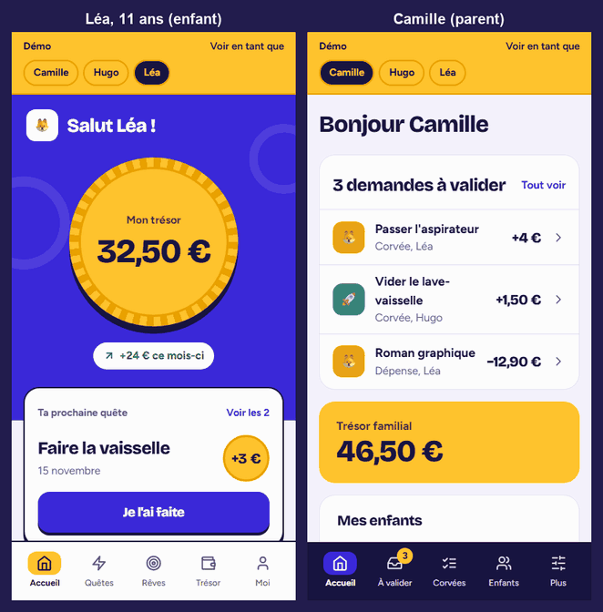
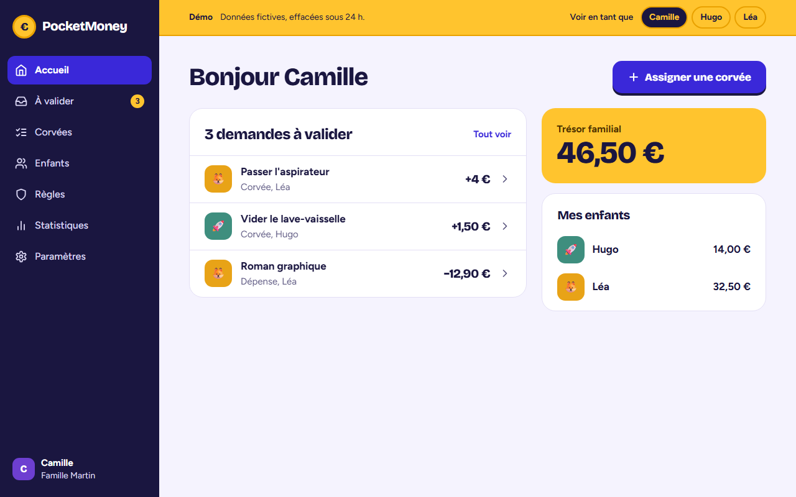
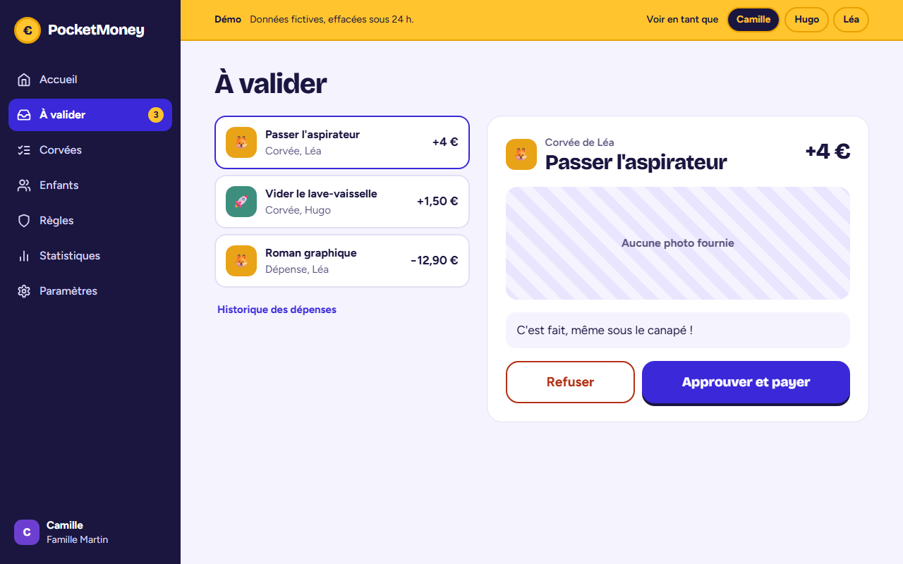
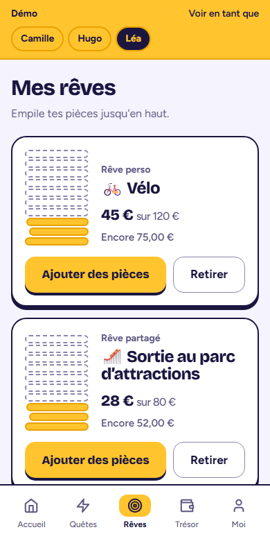

# PocketMoney

**Pocket money that kids earn.** Parents assign chores, children send proof, parents approve and the child gets paid, in real time. Kids save toward goals, ask before spending, and learn what money is worth.

[](https://github.com/skuullking/pocket-money/actions/workflows/ci.yml)


[](#license)

<!-- Replace with the production URL after the first deployment. -->
**▶ Live demo: coming soon.** One click, no signup: you get your own sample family, deleted after 24 hours.



*Left: Léa (child) sends a chore with a photo. Right: Camille (parent) receives it instantly, approves, and Léa's balance goes from 32,50 € to 35,50 € without a reload.*

| Parent, desktop | Child, mobile |
|---|---|
|  |  |
|  |  |

## Highlights

- **A balance that can never go negative.** Every debit runs in a transaction with a row lock and is capped at the available balance, even under 10 concurrent requests.
- **Recurring allowances without a cron.** Evaluated lazily when the app is opened, so none are missed after downtime and each is paid exactly once.
- **Realtime that cannot corrupt state.** Socket.IO events only trigger a refetch: the server stays the source of truth.
- **Secure by default.** The session lives in an httpOnly cookie, cross-site writes are refused, auth routes are rate limited, and the server refuses to start with a weak config.
- **A per-visitor demo.** Each visitor gets an isolated family that deletes itself after 24 hours, and can switch between the parent and child views.
- **Tested end to end.** 800+ automated tests on a real PostgreSQL, Playwright on desktop and mobile with WCAG AA checks, and the whole Docker production stack booted and checked in CI, backup restore included.
- **A QA pass made public.** [18 bugs found, fixed and covered by regression tests](docs/QA_BUG_REPORT.md), with before/after screenshots.

The reasoning behind each of these, and the trade-offs, are in **[docs/ARCHITECTURE.md](docs/ARCHITECTURE.md)**.

## Features

**Parents**
- Assign one-off or recurring (daily, weekly) chores, then approve or reject them with feedback
- Review spending requests, with per-request and weekly limits per child
- Set a weekly or monthly allowance, house rules and penalties
- Follow each child's balance, history and monthly statistics
- Export all family data and delete accounts (GDPR)

**Children**
- See their quests, mark them done with a photo and a note
- Watch their coins grow, with an optional save / spend / give split
- Save toward personal or shared goals
- Ask before spending

Installable as a PWA, in light and dark themes, in French.

## Stack

| Layer | Tech |
|---|---|
| Frontend | React 18, Vite, Tailwind CSS, React Router 7, Socket.IO client |
| Backend | Node.js, Express, TypeScript, Prisma, zod |
| Database | PostgreSQL 16 |
| Auth | JWT in an httpOnly cookie |
| Tests | Vitest, supertest, Testing Library, Playwright, axe |
| Production | Docker Compose, Caddy (HTTPS), nginx, daily backups, health monitor |
| CI | GitHub Actions: lint, typecheck, unit, end-to-end, full stack |

## Project structure

```
pocket-money/
├── frontend/   # React SPA: screens/, components/, context.jsx (state), api.js
├── backend/    # Express API: src/server.ts (routes), validation.ts, demo.ts, socket.ts…
│   ├── prisma/ # schema, migrations, seed
│   └── tests/  # Vitest on a real Postgres
├── e2e/        # Playwright on the production build; showcase/ makes the screenshots and GIF
├── deploy/     # Caddyfile, backup, restore, monitor, full-stack test
└── docs/       # architecture, design system, screens, QA plan and report
```

## Getting started

Requires Node.js 18+ and Docker (for the local Postgres).

```bash
git clone https://github.com/skuullking/pocket-money.git
cd pocket-money
docker compose -f docker-compose.dev.yml up -d   # local PostgreSQL
```

```bash
cd backend
cp .env.example .env       # set JWT_SECRET; uncomment DEMO_ENABLED for the demo button
npm install
npm run db:migrate
npm run db:seed            # optional sample family: sarah@dupont.fr / password123
npm run dev                # http://localhost:3001
```

```bash
cd frontend
npm install
npm run dev                # http://localhost:5173
```

### Tests

```bash
cd backend && npm test        # starts a disposable Postgres by itself
cd frontend && npm test
cd e2e && npx playwright install chromium && npm test
cd e2e && npm run showcase    # regenerates docs/screenshots (needs Python + Pillow for the GIF)
```

## Documentation

- [Architecture and technical decisions](docs/ARCHITECTURE.md)
- [Design system "Pièce d'or"](docs/POCKETMONEY_DESIGN_SYSTEM.md) and [screens and flows](docs/POCKETMONEY_WIREFRAMES_SCREENS.md)
- [QA test plan](docs/QA_TEST_PLAN.md) and [bug report](docs/QA_BUG_REPORT.md)
- [Launch checklist](docs/TODO_PUBLICATION.md)
- API: REST under `/api` (auth, family, chores, goals, expenses, transactions, rules, account, demo, health), with examples in `backend/PocketMoney_Postman_Collection.json`

## Production

The supported production target is **Docker Compose**: PostgreSQL, the app (nginx and Node in one container), Caddy for HTTPS, daily backups and a health monitor. Vercel is not supported for production because it cannot run the realtime server.

### Before the first deployment

You need a server with Docker, a domain whose DNS points at it with ports 80 and 443 open, a [Resend](https://resend.com) account with a verified sending domain, and the publisher details shown on the legal pages.

```bash
cp .env.production.example .env   # then fill it in
openssl rand -hex 32              # run twice: POSTGRES_PASSWORD and JWT_SECRET
docker compose up -d --build
```

Compose refuses to start while a required value is missing, and the API refuses placeholder secrets. Migrations run when the app container starts.

The CI `stack` job runs the whole Compose stack on `DOMAIN=localhost` with `deploy/stack-test.sh`: HTTPS through Caddy, nginx, the API and Postgres, the session cookie, Socket.IO over WebSocket, the monitor, the daily backup and the restore procedure below. The script wipes the database, so never run it on the production server.

| Variable | Required | Purpose |
|---|---|---|
| `DOMAIN` | yes | Public domain, used for the certificate and `CLIENT_URL` |
| `POSTGRES_PASSWORD`, `JWT_SECRET` | yes | Generated secrets |
| `RESEND_API_KEY`, `EMAIL_FROM` | yes | Password reset emails, from a verified domain |
| `LEGAL_OPERATOR`, `LEGAL_CONTACT`, `LEGAL_HOST` | yes | Publisher details on the legal pages |
| `SENTRY_DSN`, `SENTRY_DSN_FRONTEND` | no | Error tracking for the API and the browser |
| `ALERT_WEBHOOK_URL` | no | Slack or Discord webhook for outages, 5xx spikes and failed backups |
| `ALERT_5XX_THRESHOLD` | no | 5xx errors in 5 minutes that trigger an alert (default 10) |
| `BACKUP_RETENTION_DAYS` | no | Days of backups kept (default 14) |
| `DEMO_ENABLED` | no | `true` shows "Try the demo": one disposable family per visitor, deleted after 24 h (default `false`) |

Legal pages and the frontend DSN are compiled into the image: rebuild after changing them.

### Health and monitoring

`GET /api/health` returns 200 when the API can reach the database and 503 otherwise. Docker uses it through nginx, and the `monitor` service alerts after 3 failed minutes. That service runs on the same host, so also point an external uptime check at `https://your-domain/api/health`.

Logs are one JSON object per line, read them with `docker compose logs app`.

### Backups

The `backup` service writes a verified dump to the `db-backups` volume once a day. The volume lives on the same disk as the database, so copy the dumps off the server regularly. To restore:

```bash
docker compose stop app
docker compose exec -e CONFIRM_RESTORE=yes backup sh /deploy/restore.sh /backups/FILE.dump
docker compose start app
```

### Legal review

The privacy policy and terms in `frontend/src/screens/legal.jsx` are drafts. Have them reviewed before opening to the public, in particular parental consent for minors (GDPR article 8). The app is not built for COPPA verifiable parental consent, so do not open it to children in the United States without further work.

## License

MIT
